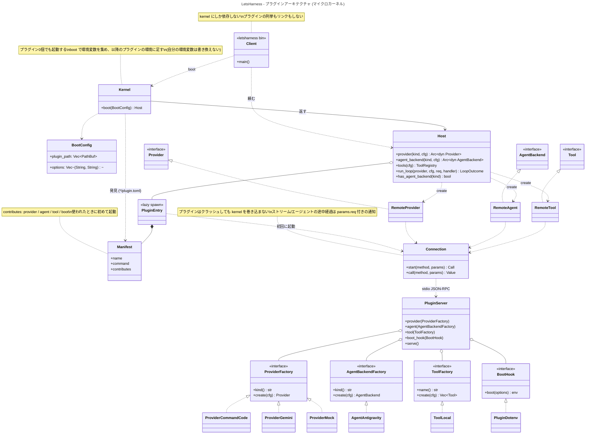
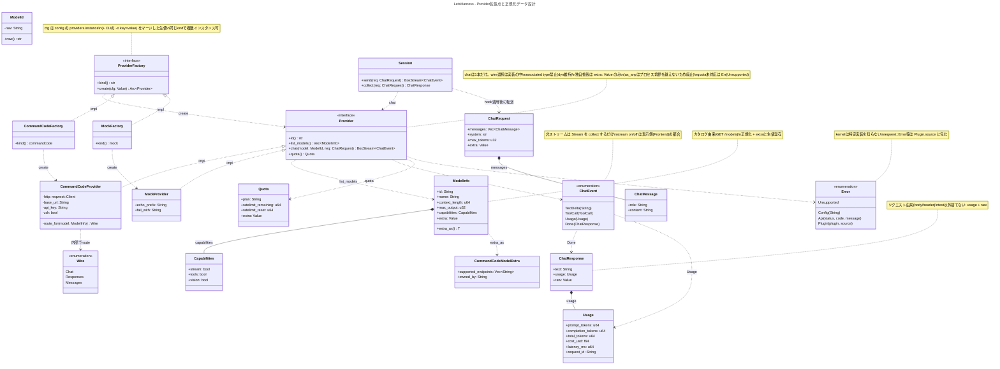

# Architecture

LetsHarness は「可能な限りすべてをプラグインにする」マイクロカーネル構成を取る。
kernel は「プラグインを発見して使う」ことだけを持ち、プロバイダ・ツール・エージェント・`.env` 読み込みなどはすべて別プロセスのプラグインとして載る。
`letsharness` は Client で、kernel を動かして `Host` に頼むだけ。モデルとツールでループを回すのは kernel の責務 (`run_loop`) で、Agent とは呼ばない。どのプラグインがあるかは Client も kernel の実装も知らず、実行時に発見される。

- 全体図: [Diagrams / Plugin architecture](#plugin-architecture)
- Provider 拡張点とデータ設計: [Diagrams / Provider](#provider)

## Layers

| Layer | 役割 | 依存してよいもの |
| --- | --- | --- |
| `kernel` | プラグインの発見・起動・通信 (`Kernel::boot` → `Host`)、ループ (`run_loop`)、共有型、拡張点 trait、プラグイン側の `PluginServer` | serde, tokio, toml (UI・HTTP ライブラリには依存しない) |
| `letsharness` (Client) | CLI。`Kernel::boot` で kernel を動かし、`Host` に `kind` 名で頼む | **kernel のみ** (+ clap 等) |
| `provider-*` | 各社 API の実装。`bin` + `plugin.toml` | kernel (+ reqwest 等) |
| `agent-*` | 外部エージェント (自分でループもツールも持つもの) を `AgentBackend` として包む。`bin` + `plugin.toml` (例: `agent-antigravity`) | kernel (+ tokio::process 等) |
| `tool-*` | エージェントが呼ぶツール。`bin` + `plugin.toml` (例: `tool-local`) | kernel |
| `plugin-*` | 起動時フックなど。`bin` + `plugin.toml` (例: `plugin-dotenv`) | kernel |

プラグイン同士・Client からプラグインへの Cargo 依存は存在しない。つながるのは実行時の発見と JSON だけ。
`kernel` が `reqwest` や `clap` に依存していないことを、分離が守られているかの目安にする。

## Principles

1. **Client は kernel を動かすだけ。** プラグインの列挙もリンクもしない。`Kernel::boot(BootConfig)` が実行時にプラグインを発見し、Client は返ってきた `Host` を使う。kernel 単体でもプラグイン0個で起動する。
2. **拡張点は kernel が決め打ちしない。** プラグインは manifest の `contributes` に文字列 ID (`provider` / `agent` / `tool` / `boot`) で宣言し、kernel はそれを `dyn Provider` / `dyn AgentBackend` / `dyn Tool` として見せる Adapter を持つ。新しい拡張点は新しい `contributes` キーとメッセージで足す。
3. **プラグインを使うのは kernel。** Client も広義のプラグインと同じ立場で、`Host` 経由でしかプラグインに触れない。プラグイン同士も互いを知らない。起動前の処理 (`.env` など) は `boot` で環境変数を返す形にし、kernel 自身の環境は書き換えない。
4. **Client は Provider を直接呼ばない。** 必ず `Host` (将来は `Session`) を経由し、hook と tool がどの Client からでも同じように効くようにする。
5. **モデルとエージェントを分ける。** 分ける軸は認証方式 (APIキー / CLI のログイン) ではなく「エージェントループを誰が回すか」。1回の呼び出しがモデル1回で、ツール・履歴をこちらが持つものは `Provider`。ループ・ツール・会話履歴を相手が持つもの (Antigravity CLI など) は `AgentBackend`。CLI の保存済み認証情報で API を直接叩くなら、それは `Provider`。
6. **Provider の `chat` は1本。** wire（chat/completions, responses, messages）の選択は各 Provider の内部事情。戻り値は `BoxStream<ChatEvent>` で、非ストリームは collect するだけ。
7. **kernel の型はプロセス境界を越えられる形にする。** 独自拡張は `extra: serde_json::Value` のみとし、`as_any()` のような境界を越えないものは使わない。エラーは `Unsupported` / `Config` / `Api` / `Plugin { source }` に限定し、特定実装の型を持ち込まない。
8. **プロバイダは「種類 (kind)」と「インスタンス」を分ける。** 同じ kind をキーや設定を変えて複数インスタンス化できる。設定ファイルが無い場合は kind と同名のインスタンスを暗黙に作る。

## Extension points

プラグイン側は `PluginServer` に factory を登録して `serve()` するだけ。kernel 側は manifest を見て、使われたときに起動する。

| 拡張点 | プラグインが実装する trait | Client から見える形 | 用途 |
| --- | --- | --- | --- |
| `provider` | `ProviderFactory` → `Provider` | `Host::provider(kind, cfg)` → `Arc<dyn Provider>` | LLM API。`create(cfg: Value)` でインスタンス化 |
| `agent` | `AgentBackendFactory` → `AgentBackend` | `Host::agent_backend(kind, cfg)` | ループもツールも自分で持って最終回答まで自走する外部エージェント。途中経過と承認はプロセス間で往復する |
| `tool` | `ToolFactory` → `Tool` | `Host::tools(cfg)` → `ToolRegistry` | エージェントが呼ぶツール。スキーマは MCP と同形 |
| `boot` | `BootHook` | (Kernel が起動時に呼ぶ) | 返した環境変数が、以降に起動するプラグインの環境に足される |

## Provider / Loop / Agent

- **Provider**: モデルを1回呼ぶだけ。履歴もツール実行も持たない。
- **Loop**: モデル呼び出し → ツール実行 → 結果を返して再呼び出し、を最終回答まで繰り返す。**kernel の責務** (`run_loop`、`Host::run_loop`)。使う `Provider` と `Tool` は `Host` が引いたもので、どのプラグインのものかは知らない。承認と途中経過は `RunHandler` で Client に委ねる。
- **Agent**: ループもツールも相手が持っていて、こちらは依頼を渡して結果と途中経過を受け取るだけのもの (Antigravity CLI など)。`AgentBackend` の拡張点。

Loop は Agent ではないので、プラグインにはしない。Client は `loop` (Loop) と `agent` (外部エージェント。`--backend` で kind を選ぶ) を別のコマンドとして持つ。

## Writing a plugin

```toml
# plugin.toml
name = "mock"
command = "letsharness-provider-mock"   # manifest のあるディレクトリ → kernel の実行ファイルと同じ場所 → PATH の順に探す

[contributes]
provider = ["mock"]
```

```rust
#[tokio::main]
async fn main() {
	PluginServer::new().provider(MockFactory).serve().await;
}
```

発見先 (`BootConfig::plugin_path`) は `$LETSHARNESS_PLUGIN_PATH` → 実行ファイル横の `plugins/` → `~/.letsharness/plugins`。各ディレクトリの直下 `*/plugin.toml` を読む。
開発中は `.cargo/config.toml` が `LETSHARNESS_PLUGIN_PATH=crates` を設定するので、`cargo build --workspace` したあと `cargo run -p letsharness -- ...` でそのまま動く。

## Configuration

優先順位は `デフォルト < 設定ファイル < 環境変数 < CLI (-o key=value)`。

`.env` は `crates/plugin-dotenv` が `boot` で読み、未設定の環境変数だけを返す（`.env < 環境変数`）。kernel はそれを以降に起動するプラグインの環境に足す。カレントから親へ遡って探し、`-o env_file=<PATH>` で指定、`-o no_env_file=true` で無効化できる。

プラグイン固有の設定は専用フラグを持たず、`-o key=value` で渡す (`boot` を持つプラグインと、選択中のインスタンスに届く)。例: mock の `-o prefix=">> "` / `-o error=boom`。

```toml
frontend = "cli"
default_provider = "cc"

[providers.cc]
kind = "commandcode"
zdr  = true

[providers.echo]
kind   = "mock"
prefix = ">> "

[[plugins]]   # 外部プラグイン
path = "~/.letsharness/plugins/openai-compat"
```

プロバイダ固有の設定は CLI フラグとしては定義しない。`-o key=value` で選択中のインスタンスの設定を上書きする。

## External plugins

- すべてのプラグインは別プロセス。Rust の ABI で dylib を読み込むことはしない。プラグインがクラッシュしても kernel は巻き込まれない。
- 運ぶ手段は **stdio (1行1メッセージの JSON-RPC 風)**。メッセージは `crates/kernel/src/rpc.rs`。
  - リクエスト `{id, method, params}` → 応答 `{id, result}` / `{id, error: {kind, message, ...}}`。
  - ストリームやエージェントの途中経過は、`params.req` に元リクエストの id を入れた通知で流す。承認のようなプラグインから kernel への問い合わせも、同じ `req` を持つリクエスト。
  - kernel → プラグイン: `boot` / `provider.create` / `provider.<Provider の各メソッド>` / `agent.create` / `agent.list_models` / `agent.run` / `tool.create` / `tool.call`。
  - プラグイン → kernel (`agent.run` の最中のみ): `agent.approve`。
- プラグインは使われるときに初めて起動し、以降は同じプロセスを使う。
- 運ぶ手段は差し替え可能な設計のまま。高頻度呼び出しや C/C++/Zig 製が必要になれば C ABI、サンドボックスが必要になれば WASM component model を検討する。
- Tool は MCP クライアントを実装し、既存の MCP サーバーをそのまま `dyn Tool` として使う (未着手)。Provider には MCP 相当の標準がないため独自プロトコル。

## Roadmap

1. `Provider` trait を `chat(model, req) -> BoxStream<ChatEvent>` 1本に作り直し、wire 選択を各プロバイダへ移す。設定ファイル (`default_provider` / `[providers.x]`) を導入する。いまの `Provider` は多数のメソッドを持ち、そのまま線の上を流れている。
2. **完了**: kernel が外部プラグインを発見・起動・通信する (`Kernel::boot` / `Host` / `PluginServer`)。Client は `crates/letsharness` で kernel のみに依存する。
3. `Session` を挟み、`Hook` (before_request / on_tool_call / after_response) を効かせる。
4. MCP クライアント。`Tool` / `ToolRegistry`、ローカルツール (`crates/tool-local`)、kernel のループ (`run_loop`、`letsharness loop`)、外部エージェント `crates/agent-antigravity` (`letsharness agent --backend antigravity`) は実装済み。
5. プラグインの配布 (`plugins/` への導入手順、`cargo xtask install` 相当)。
6. 必要になったら TUI / Server の Client、C ABI / WASM transport。

## Diagrams

### Plugin architecture



### Provider


