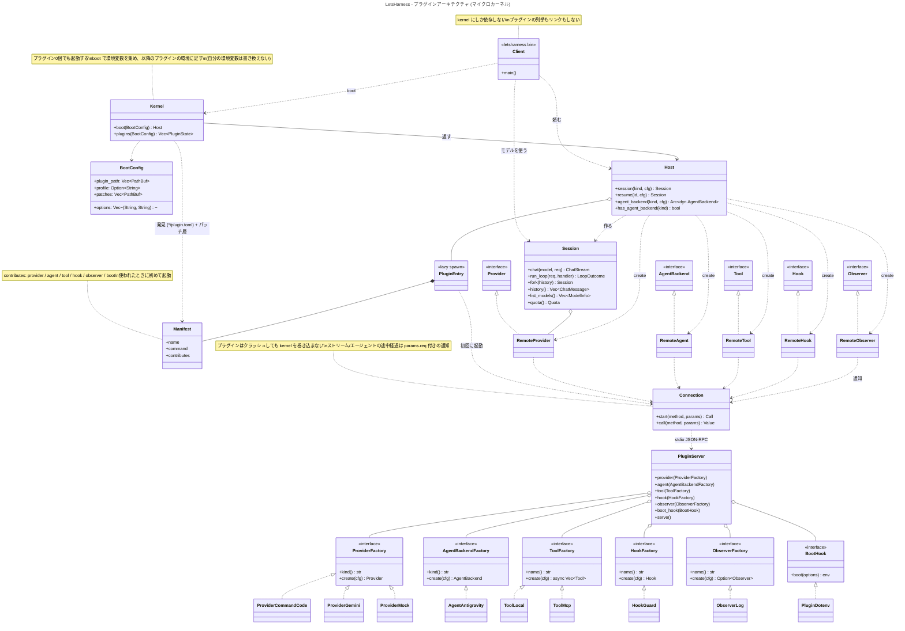

# Architecture

LetsHarness は「可能な限りすべてをプラグインにする」マイクロカーネル構成を取る。
kernel は「プラグインを発見して使う」ことだけを持ち、プロバイダ・ツール・エージェント・`.env` 読み込みなどはすべて別プロセスのプラグインとして載る。
`letsharness` は Client で、kernel を動かして `Host` に頼み、モデルは `Host` が作る `Session` 経由で使うだけ。モデルとツールでループを回すのは kernel の責務 (`run_loop`) で、Agent とは呼ばない。どのプラグインがあるかは Client も kernel の実装も知らず、実行時に発見される。

- 全体図: [Diagrams / Plugin architecture](#plugin-architecture)
- Provider 拡張点とデータ設計: [Diagrams / Provider](#provider)

## Layers

| Layer | 役割 | 依存してよいもの |
| --- | --- | --- |
| `kernel` | プラグインの発見・起動・通信 (`Kernel::boot` → `Host`)、`Session`、ループ (`run_loop`)、共有型、拡張点 trait、プラグイン側の `PluginServer` | serde, tokio, toml (UI・HTTP ライブラリには依存しない) |
| `letsharness` (Client) | CLI。`Kernel::boot` で kernel を動かし、`Host` に `kind` 名で頼む | **kernel のみ** (+ clap 等) |
| `provider-*` | 各社 API の実装。`bin` + `plugin.toml` | kernel (+ reqwest 等) |
| `agent-*` | 外部エージェント (自分でループもツールも持つもの) を `AgentBackend` として包む。`bin` + `plugin.toml` (例: `agent-antigravity`) | kernel (+ tokio::process 等) |
| `tool-*` | エージェントが呼ぶツール。`bin` + `plugin.toml` (例: `tool-local`、MCP クライアントの `tool-mcp`) | kernel (+ reqwest 等) |
| `hook-*` | ループ (`run_loop`) に割り込む Hook。`bin` + `plugin.toml` (例: `hook-guard`) | kernel |
| `observer-*` | ループの出来事を見るだけの Observer。`bin` + `plugin.toml` (例: `observer-log`) | kernel |
| `plugin-*` | 起動時フックなど。`bin` + `plugin.toml` (例: `plugin-dotenv`) | kernel |

プラグイン同士・Client からプラグインへの Cargo 依存は存在しない。つながるのは実行時の発見と JSON だけ。
`kernel` が `reqwest` や `clap` に依存していないことを、分離が守られているかの目安にする。

## Principles

1. **Client は kernel を動かすだけ。** プラグインの列挙もリンクもしない。`Kernel::boot(BootConfig)` が実行時にプラグインを発見し、Client は返ってきた `Host` を使う。kernel 単体でもプラグイン0個で起動する。
2. **拡張点は kernel が決め打ちしない。** プラグインは manifest の `contributes` に文字列 ID (`provider` / `agent` / `tool` / `hook` / `observer` / `boot`) で宣言し、kernel はそれを `dyn Provider` / `dyn AgentBackend` / `dyn Tool` / `dyn Hook` / `dyn Observer` として見せる Adapter を持つ。新しい拡張点は新しい `contributes` キーとメッセージで足す。
3. **プラグインを使うのは kernel。** Client も広義のプラグインと同じ立場で、`Host` 経由でしかプラグインに触れない。プラグイン同士も互いを知らない。起動前の処理 (`.env` など) は `boot` で環境変数を返す形にし、kernel 自身の環境は書き換えない。
4. **Client は Provider を直接呼ばない。** 必ず `Host::session` が作る `Session` を経由し、Hook と Observer がどの Client からでも同じように効くようにする。`Host` は Provider・ツール・Hook を単体では渡さない。
5. **モデルとエージェントを分ける。** 分ける軸は認証方式 (APIキー / CLI のログイン) ではなく「エージェントループを誰が回すか」。1回の呼び出しがモデル1回で、ツール・履歴をこちらが持つものは `Provider`。ループ・ツール・会話履歴を相手が持つもの (Antigravity CLI など) は `AgentBackend`。CLI の保存済み認証情報で API を直接叩くなら、それは `Provider`。
6. **Provider の `chat` は1本。** `Provider` は `list_models` / `chat(model, ChatRequest) -> ChatStream` / `quota` だけを持つ。wire（chat/completions, responses, messages）の選択とストリームで受けるかどうかは各 Provider の内部事情。戻り値は `ChatEvent` (`text_delta` / `thinking_delta` / 最後に `done`) の流れで、一括で欲しい側は `collect` するだけ。
7. **kernel の型はプロセス境界を越えられる形にする。** 独自拡張は `extra: serde_json::Value` のみとし、`as_any()` のような境界を越えないものは使わない。エラーは `Unsupported` / `Config` / `Api` / `Plugin { source }` に限定し、特定実装の型を持ち込まない。
8. **プロバイダは「種類 (kind)」と「インスタンス」を分ける。** 同じ kind をキーや設定を変えて複数インスタンス化できる。設定ファイルが無い場合は kind と同名のインスタンスを暗黙に作る。

## Extension points

プラグイン側は `PluginServer` に factory を登録して `serve()` するだけ。kernel 側は manifest を見て、使われたときに起動する。

| 拡張点 | プラグインが実装する trait | Client から見える形 | 用途 |
| --- | --- | --- | --- |
| `provider` | `ProviderFactory` → `Provider` | `Host::session(provider, cfg)` の中 | LLM API。`create(cfg: Value)` でインスタンス化 |
| `agent` | `AgentBackendFactory` → `AgentBackend` | `Host::agent_backend(kind, cfg)` | ループもツールも自分で持って最終回答まで自走する外部エージェント。途中経過はプロセス間で通知として流れる |
| `tool` | `ToolFactory` → `Tool` | `Session` に全部入る | エージェントが呼ぶツール。スキーマは MCP と同形 |
| `hook` | `HookFactory` → `Hook` | `Session` に全部入る (並びは発見順) | ループに割り込む。モデル呼び出しとツール実行の前後で、リクエスト・応答・ツール呼び出し・結果を書き換えたり止めたりする |
| `observer` | `ObserverFactory` → `Observer` | `Session` に全部入る | ループの出来事 (`Event`) を見るだけ。書き換えも停止もできず、ループは待たない |
| `boot` | `BootHook` | (Kernel が起動時に呼ぶ) | 返した環境変数が、以降に起動するプラグインの環境に足される |

### Hook

ループ自体は変えずに振る舞いを足すための口。DeepSeek Harness (Cordis) の waterfall / bail イベントに当たる。

| 箇所 (`HookPoint`) | 受け取るもの → 返すもの | 効き方 |
| --- | --- | --- |
| `before_request` | `ModelRequest` → `ModelRequest` | その1回のリクエストだけに効く。ループの履歴 (`LoopOutcome::messages`) には残らない |
| `after_response` | `Completion` → `Completion` | 書き換えた応答が履歴に残り、ツール呼び出しもそれに従う |
| `on_tool_call` | `ToolCall` → `ToolDecision` | `Run { call }` で (書き換えて) 実行、`Skip { output }` で実行せず結果を差し込む。`call.id` は書き換えても元に戻る |
| `after_tool_call` | `(ToolCall, ToolOutput)` → `ToolOutput` | モデルに返す結果を書き換える (伏せ字・切り詰めなど)。`Skip` で差し込んだ結果にも効く |

- 複数の Hook は直列につながり、前の出力が次の入力になる。順はプラグインの発見順 → manifest の `contributes.hook` の記載順。`on_tool_call` は最初の `Skip` で止まる。
- Hook は `points()` で割り込む箇所を宣言し、挙げた箇所だけが呼ばれる (割り込まない Hook のためにプロセス間で履歴を往復させない)。設定次第で何もしないなら空を返す。
- Hook が `Err` を返すと (通信の失敗も含めて) ループはそこで止まる。ツールの失敗と違ってモデルには見せない。ポリシーを黙って素通りさせないため。
- `cfg` はツールと同じくループに渡る設定 (`-o key=value` と `workdir`)。`create` には同じループで使うツールの一覧も渡るので、設定の食い違い (存在しないツール名など) は `Err(Config)` で起動時に止める。黙って無視しない。
- 例: `hook-guard` は `-o deny_tools=bash,write_file` のツールを `Skip` し、知らないツール名なら起動を止める。

### Observer

ログやテレメトリのように見るだけのもののための口。DeepSeek Harness (Cordis) の `emit` イベントに当たる。Hook と違ってループは Observer を待たない。

- 届く `Event` は `request` (モデルに送るリクエスト) / `response` (モデルの応答) / `tool_result` (モデルに返すツールの結果) の3つ。どれも Hook をすべて通した後の値で、起きた順に届く。
- kernel → プラグインの通知 (`observer.event`) で送り、応答を待たない。プラグインは通知を届いた順にその場で処理する。
- 呼び出しが返る前に `observer.flush` で、それまでの出来事を処理し終えるまで待つ。プロセスを終えても取りこぼさないため。
- 送れなかった出来事は警告して捨てる。見るだけの口なのでループは止めない。
- `create` が `None` を返せば (設定が無いなど)、出来事は送られない。例: `observer-log` は `-o event_log=PATH` のときだけ JSON Lines で追記する。

## Session

`Host::session(provider, cfg)` (`provider` は設定ファイルのインスタンス名か kind) が Provider・ツール・Hook・Observer をひとまとめにした `Session` を作る。Client がモデルを使う窓口はこれだけ (CLI の `models` / `chat` / `quota` / `loop` も GUI も)。1つの `Session` が1つの会話で、会話の履歴は `Session` が持つ。Client は毎ターンの新しいメッセージだけを渡す。

- `Session::chat(model, req) -> ChatStream`: ツールを使わない1回の呼び出し。`req.messages` (このターンの新しいメッセージ) を履歴に続けて送る。`before_request` / `after_response` の Hook を通し、Observer に知らせる。差分 (`text_delta` / `thinking_delta`) は Hook を通す前の本文で、最後の `done` が Hook を通した応答。`req.tools` が空でなければ `Err(Config)`。ストリームを途中で捨てるとターンはそこで止まる。
- `Session::run_loop(req, handler)`: ツールを使いながら最終回答まで (下の Loop)。`req.messages` はこのターンの新しいメッセージ。
- 成功したターンだけが履歴に加わる (ループは途中のツール往復ごと)。失敗・中断したターンは履歴に残らない。同じ `Session` のターンは1つずつ進む。
- `before_request` の書き換えはリクエストにだけ効き、履歴には入らない。`after_response` の書き換えは履歴に入る。
- どちらも返る前に Observer を flush する。
- ツールは Hook より先に作り、その一覧を Hook の `create` に渡す。
- `Session::fork(history)` は同じ Provider・ツール・Hook で、`history` から始まる別の会話を作る (プラグインとやりとりしない)。GUI は会話ごとに fork し、プロバイダを切り替えた会話は画面の履歴を引き継いで fork し直す。

### セッションログ

会話は `<home>/sessions/<id>.jsonl` (`BootConfig::sessions_dir`) に追記だけで残る。最初に書くときにファイルを作るので、`models` などで会話しなかった Session はファイルを作らない。

- 1行目は見出し `{"type":"session","version","id","provider"}`。
- `{"type":"event", ...}`: Hook を通した後にモデル・ツールとやりとりした値 (Observer と同じ `request` / `response` / `tool_result`)。モデルに何が見えたか (`before_request` の書き換えを含む) はここに残る。
- `{"type":"message","message"}`: 履歴に加わったメッセージ。ターンが成功したときにまとめて書く。
- `Host::resume(id, cfg)` は `message` だけを読んで履歴を復元し、同じファイルに続きを書く。Provider はログの `provider` を使う。見出しが無い・版が違う・途中の行が壊れているログは読まずに止める (改行で終わらない最後の行だけは書きかけとして警告して捨てる)。
- CLI は `chat` / `loop` の後に `session: <id>` を表示し、`--resume <id>` で続ける。`--resume` では `--system` は使えない (履歴の途中に挟まないため)。
- ログに書けなくても会話は止めずに警告し、書けなかった分は次のターンで書き直す。

## Provider / Loop / Agent

- **Provider**: モデルを1回呼ぶだけ。履歴もツール実行も持たない。
- **Loop**: モデル呼び出し → ツール実行 → 結果を返して再呼び出し、を最終回答まで繰り返す。**kernel の責務** (`run_loop`、`Session::run_loop`)。使う `Provider` と `Tool` は `Host` が引いたもので、どのプラグインのものかは知らない。途中経過は `RunHandler` で Client に委ねる。ツールは承認なしで実行される (`bash` は cwd を決めるだけで何でも実行できるので、信頼できない入力には使わない)。
- **Agent**: ループもツールも相手が持っていて、こちらは依頼を渡して結果と途中経過を受け取るだけのもの (Antigravity CLI など)。`AgentBackend` の拡張点。

Loop は Agent ではないので、プラグインにはしない。Client は `loop` (Loop) と `agent` (外部エージェント。`--backend` で kind を選ぶ) を別のコマンドとして持つ。

## Writing a plugin

```toml
# plugin.toml
name = "mock"
command = "letsharness-provider-mock"   # manifest のあるディレクトリ → kernel の実行ファイルと同じ場所 → PATH の順に探す

[contributes]
provider = ["mock"]
```

```rust
#[tokio::main]
async fn main() {
	PluginServer::new().provider(MockFactory).serve().await;
}
```

発見先 (`BootConfig::plugin_path`) は `$LETSHARNESS_PLUGIN_PATH` → 実行ファイル横の `plugins/` → `~/.letsharness/plugins`。各ディレクトリの直下 `*/plugin.toml` を読む。そのうえで [パッチ層](#profile-とパッチ層) を重ねる。
開発中は `.cargo/config.toml` が `LETSHARNESS_PLUGIN_PATH=crates` を設定するので、`cargo build --workspace` したあと `cargo run -p letsharness -- ...` でそのまま動く。

## Configuration

優先順位は `デフォルト < 設定ファイル < 環境変数 < CLI (-o key=value)`。

### Profile とパッチ層

どのプラグインを使い、どの順に並べ、どんな設定を渡すかは、層を重ねて決める。DeepSeek Harness の profile / bundle / `cordis.patch.yml` に当たる。

1. 発見したプラグイン (すべて有効・発見順)
2. profile のパッチ `<home>/profiles/<profile>/patch.toml` (無ければ空)。`<home>` は `$LETSHARNESS_HOME` → `~/.letsharness`、profile は `--profile` → `$LETSHARNESS_PROFILE` → `default`
3. `--patch FILE` (指定順。ファイルが無ければ起動を止める)

```toml
[[plugins]]
id = "guard"                        # manifest の name
order = -10                         # 小さいほど先 (既定 0、同じなら発見順)。Hook の割り込む順にも効く
config = { deny_tools = "bash" }    # このプラグインに渡す設定。前の層の config を丸ごと置き換える

[[plugins]]
path = "~/src/my-plugin"            # 発見されていないプラグインを足す。相対パスはこのファイルから
disabled = true
```

- 行は書いたフィールドだけが前の層を上書きする。プラグインに渡る `cfg` は `config` に `-o key=value` (と `workdir`) を上書きしたもの。
- 知らない `id`・名前の重複・未知のフィールドは、ファイルと行を添えて起動を止める。黙って無視しない。
- `letsharness plugin list` で層を重ねた結果を、`plugin enable <id>` / `plugin disable <id>` で profile のパッチを書き換える (プラグインは起動しない)。既定 (有効) に戻すと行は消え、profile には既定との差分だけが残る。書き戻すときコメントは残らない。
- GUI は `$LETSHARNESS_PROFILE` の profile を使う。

### 設定ファイル

`<home>/config.toml` (`$LETSHARNESS_CONFIG` か `--config FILE` で変えられる。既定の場所に無ければ空の設定) で、Provider に名前を付けて既定を決める。

```toml
default_provider = "work"     # --provider を省いたときの名前 (無ければ CLI は commandcode)

[providers.work]
kind = "commandcode"          # 省略すると表の名前を kind とみなす
wire = "messages"             # kind 以外はそのまま Provider の cfg に渡る

[providers.echo]
kind   = "mock"
prefix = ">> "
```

- `--provider` にはインスタンス名か kind を渡す。表に無い名前は kind とみなし、cfg は空。同じ kind で複数のインスタンスを持てる。
- Provider の cfg は「パッチ層のプラグイン設定 → 設定ファイルの表 → `-o key=value`」の順に上書きされる。
- セッションログにはこの名前が残り、`--resume` は設定ファイルの表をまた引く。
- 未知のトップレベルのキーは起動を止める。インスタンスの kind が無いことは、そのインスタンスを使うときにエラーになる。
- GUI のプロバイダ一覧は `Host::provider_names` (インスタンス名 → それ以外の kind) で、初期値は `default_provider`。

`.env` は `crates/plugin-dotenv` が `boot` で読み、未設定の環境変数だけを返す（`.env < 環境変数`）。kernel はそれを以降に起動するプラグインの環境に足す。カレントから親へ遡って探し、`-o env_file=<PATH>` で指定、`-o no_env_file=true` で無効化できる。

プラグイン固有の設定は専用フラグを持たず、`-o key=value` で渡す (`boot` を持つプラグインと、選択中のインスタンスに届く)。例: mock の `-o prefix=">> "` / `-o error=boom`、commandcode の `-o wire=messages`。
プロバイダ固有の設定は CLI フラグとしては定義しない。例外は `chat --route` で、リクエストの `extra.wire` になる (commandcode が使い、他は無視する)。

## External plugins

- すべてのプラグインは別プロセス。Rust の ABI で dylib を読み込むことはしない。プラグインがクラッシュしても kernel は巻き込まれない。
- 運ぶ手段は **stdio (1行1メッセージの JSON-RPC 風)**。メッセージは `crates/kernel/src/rpc.rs`。
  - リクエスト `{id, method, params}` → 応答 `{id, result}` / `{id, error: {kind, message, ...}}`。向きは kernel → プラグインのみ (通知は両方向)。
  - ストリームやエージェントの途中経過は、`params.req` に元リクエストの id を入れた通知で流す。
  - 型の後方互換は保証しない。プラグインと kernel は同じバージョンでビルドする。
  - kernel → プラグイン: `boot` / `provider.create` / `provider.list_models` / `provider.chat` / `provider.quota` / `agent.create` / `agent.list_models` / `agent.run` / `tool.create` / `tool.call` / `hook.create` / `hook.before_request` / `hook.on_tool_call` / `hook.after_response` / `hook.after_tool_call` / `observer.create` / `observer.flush`。
  - kernel → プラグインの通知: `observer.event` (応答なし)。
  - プラグイン → kernel の通知: `stream.delta` / `stream.thinking` (`provider.chat` の差分。応答は `Completion`) と `agent.on_*`。
- プラグインは使われるときに初めて起動し、以降は同じプロセスを使う。
- 運ぶ手段は差し替え可能な設計のまま。高頻度呼び出しや C/C++/Zig 製が必要になれば C ABI、サンドボックスが必要になれば WASM component model を検討する。
- Tool は MCP クライアント (`crates/tool-mcp`) で、既存の MCP サーバーをそのまま `dyn Tool` として使う ([MCP](#mcp))。Provider には MCP 相当の標準がないため独自プロトコル。

## MCP

`crates/tool-mcp` (プラグイン名 `mcp`、`contributes.tool = ["mcp"]`) が MCP サーバーにつなぎ、そのツールを `mcp__<server>__<tool>` という名前のツールとして供給する。kernel は MCP を知らない (ほかのツールと同じ `tool.create` / `tool.call`)。

- つなぐサーバーは cfg で決める。`mcp_servers` (サーバー名 → 設定。パッチ層の `config` に書くか、`-o mcp_servers='<JSON>'`) と `mcp_config` (`.mcp.json` 形 `{"mcpServers": {...}}` のファイル)。どちらも無ければツールは無い。同じ名前は `mcp_servers` が勝つ。
- サーバーの設定は `command` / `args` / `env` / `cwd` (stdio) か `type = "http"` + `url` / `headers` (Streamable HTTP)。古い HTTP+SSE (`type = "sse"`) は未対応で、起動を止める。文字列の `${VAR}` / `${VAR:-既定}` は環境変数に置き換える。
- stdio のサーバーの作業ディレクトリは `cwd` (相対なら `cfg.workdir` から)、無ければ `cfg.workdir` (`loop --workdir`)。サーバーの標準エラーは表示せず、落ちたときのエラーに最後の数行を添える。
- 使うメソッドは `initialize` → `notifications/initialized` → `tools/list` (`nextCursor` を追う) / `tools/call`。サーバーからのリクエストは `ping` にだけ答える。`timeout_secs` (既定 300) が1回の呼び出し、`startup_timeout_secs` (既定 60) が `initialize` の上限。
- 結果の `text` はそのまま、`resource` は中身のテキスト、画像などは `[image: image/png]` のように種類だけをモデルに返す。テキストが無く `structuredContent` があればその JSON。`isError` はツールの失敗になる。
- つなげないサーバーがあれば Session を作るところで止める (黙って飛ばさない)。同じ設定のサーバーへの接続はプラグインの中で使い回す。

```toml
# <home>/profiles/default/patch.toml
[[plugins]]
id = "mcp"
config.mcp_servers.fs = { command = "npx", args = ["-y", "@modelcontextprotocol/server-filesystem", "."] }
config.mcp_servers.docs = { type = "http", url = "https://example.com/mcp", headers = { Authorization = "Bearer ${DOCS_TOKEN}" } }
```

## Roadmap

1. **完了**: `Provider` trait を `chat(model, req) -> ChatStream` 1本に作り直し、wire 選択を各プロバイダへ移した (commandcode は `Wire::for_model`、`wire` で決め打ち)。設定ファイル (`default_provider` / `[providers.x]`) を導入した。
2. **完了**: kernel が外部プラグインを発見・起動・通信する (`Kernel::boot` / `Host` / `PluginServer`)。Client は `crates/letsharness` で kernel のみに依存する。
3. `Session` を挟み、`Hook` (before_request / on_tool_call / after_response / after_tool_call) を効かせる。`Hook` 拡張点と `run_loop` への適用は実装済み (`crates/hook-guard`)。`Session` も実装済みで、`chat` / GUI にも Hook と Observer が効く。会話の履歴は `Session` が持ち、セッションログから `--resume` で再開できる。
4. **完了**: MCP クライアント (`crates/tool-mcp`、stdio / Streamable HTTP)。`Tool` / `ToolRegistry`、ローカルツール (`crates/tool-local`)、kernel のループ (`run_loop`、`letsharness loop`)、外部エージェント `crates/agent-antigravity` (`letsharness agent --backend antigravity`) も実装済み。
5. プラグインの配布 (`plugins/` への導入手順、`cargo xtask install` 相当)。profile とパッチ層 (有効/無効・並び順・プラグインごとの設定・`path` での追加) と `letsharness plugin list/enable/disable` は実装済み。
6. 必要になったら TUI / Server の Client、C ABI / WASM transport。

## Diagrams

### Plugin architecture



### Provider

```mermaid
---
title: LetsHarness - Provider拡張点と正規化データ設計
---
classDiagram
  %% ---- kernel: Provider拡張点 / Narrow waist ----
  class ProviderFactory {
    <<interface>>
    +kind() str
    +create(cfg: Value) Arc~Provider~
  }
  class Provider {
    <<interface>>
    +name() str
    +list_models() Vec~ModelInfo~
    +chat(model, req: ChatRequest) ChatStream
    +quota() Quota
  }
  class Session {
    +chat(model, req: ChatRequest) ChatStream
  }
  class ModelInfo {
    +id: String
    +name: String
    +context_length: u64
    +max_output: u32
    +capabilities: Capabilities
    +extra: Value
    +extra_as() T
  }
  class Capabilities {
    +stream: bool
    +tools: bool
    +vision: bool
  }
  class ChatRequest {
    +messages: Vec~ChatMessage~
    +tools: Vec~ToolSpec~
    +max_tokens: Option~u32~
    +extra: Value
  }
  class ChatMessage {
    +role: String
    +content: String
  }
  class ChatEvent {
    <<enumeration>>
    TextDelta(text)
    ThinkingDelta(text)
    Done(Completion)
  }
  class Completion {
    +text: String
    +thinking: Option~String~
    +tool_calls: Vec~ToolCall~
    +usage: Option~Usage~
  }
  class Usage {
    +prompt_tokens: u64
    +completion_tokens: u64
    +total_tokens: u64
    +cost_usd: f64
    +latency_ms: u64
    +request_id: String
  }
  class Quota {
    +plan: String
    +ratelimit_remaining: u64
    +ratelimit_reset: u64
    +extra: Value
  }
  class Error {
    <<enumeration>>
    Unsupported
    Config(String)
    Api(status, code, message)
    Plugin(plugin, source)
  }

  %% ---- provider-commandcode (プラグイン) ----
  class CommandCodeFactory {
    +kind() commandcode
  }
  class CommandCodeProvider {
    -http: reqwest::Client
    -base_url: String
    -api_key: String
    -zdr: bool
    -wire: Option~Wire~
    -auto_wire(model, req) Wire
  }
  class Wire {
    <<enumeration>>
    Chat
    Responses
    Messages
  }
  class CommandCodeModelExtra {
    +supported_endpoints: Vec~String~
    +owned_by: String
  }

  %% ---- provider-mock (プラグイン) ----
  class MockFactory {
    +kind() mock
  }
  class MockProvider {
    +echo_prefix: String
    +fail_with: String
  }

  %% --- relations ---
  ProviderFactory ..> Provider : create
  Session ..> Provider : chat
  Session ..> ChatRequest : hook適用後に転送

  ProviderFactory <|.. CommandCodeFactory : impl
  ProviderFactory <|.. MockFactory : impl
  Provider <|.. CommandCodeProvider : impl
  Provider <|.. MockProvider : impl
  CommandCodeFactory ..> CommandCodeProvider : create
  MockFactory ..> MockProvider : create

  Provider ..> ModelInfo : list_models
  Provider ..> ChatEvent : chat
  Provider ..> Quota : quota
  Provider ..> Error : Err
  CommandCodeProvider ..> Wire : 内部でroute

  ModelInfo *-- Capabilities : capabilities
  ModelInfo ..> CommandCodeModelExtra : extra_as
  ChatRequest *-- ChatMessage : messages
  ChatEvent ..> Completion : Done
  ChatEvent ..> Usage : Usage
  Completion *-- Usage : usage

  note for Provider "chatは1本だけ。wire選択は実装の中\nassociated type禁止(dyn維持)\n独自拡張は extra: Value のみ\n(as_anyはプロセス境界を越えないため廃止)\nquota未対応は Err(Unsupported)"
  note for ChatEvent "非ストリームは Stream を collect するだけ\nstream on/off は表示側(Frontend)の都合"
  note for ModelInfo "カタログ由来(GET /models)\n正規化 + extraに生値温存"
  note for Completion "リクエスト由来(body/header)\n差分をつないだ本文 + ツール呼び出し + usage"
  note for Error "kernelは特定実装を知らない\nreqwest::Error等は Plugin.source に包む"
  note for ProviderFactory "cfg は config の providers.instance\n(+ CLIの -o key=value) をマージした生値\n同じkindで複数インスタンス可"
```


