# Architecture

LetsHarness は「可能な限りすべてをプラグインにする」マイクロカーネル構成を取る。
kernel は拡張点の受け口と実行基盤だけを持ち、CLI・プロバイダ・ツール・フックはすべてプラグインとして載る。

- 全体図: [Diagrams / Plugin architecture](#plugin-architecture)
- Provider 拡張点とデータ設計: [Diagrams / Provider](#provider)

## Layers

| Layer | 役割 | 依存してよいもの |
| --- | --- | --- |
| `bootstrap` (`main.rs`) | 同梱プラグインの列挙、`--config` / `--frontend` の抽出、Frontend の起動 | kernel, 各プラグイン |
| `kernel` | `Registry` / `Host` / `Session` / `Config` と、汎用拡張点 trait | serde, futures (UI・HTTP ライブラリには依存しない) |
| `frontend-*` | CLI / TUI / Server などのユーザー接点 | kernel (+ clap 等) |
| `provider-*` | 各社 API の実装 | kernel (+ reqwest 等) |
| `plugin-host` | 外部プラグインの発見・起動・Transport・MCP クライアント | kernel |

`kernel` が `reqwest` や `clap` に依存していないことを、分離が守られているかの目安にする。

## Principles

1. **main.rs はロジックを持たない。** どのプラグインを同梱するかを決めるだけの composition root（ディストリのマニフェスト）。将来は kernel をライブラリとして公開し、ユーザーが自分の `main.rs` で独自ハーネスを組めるようにする。
2. **拡張点は kernel が決め打ちしない。** `Registry` は `TypeId` をキーにした汎用の入れ物で、拡張点の trait はそれを使うプラグインが定義してよい（例: `CliCommand` は `frontend-cli` が定義する）。
3. **Frontend は Provider を直接呼ばない。** 必ず `Host` / `Session` を経由し、hook と tool がどの Frontend からでも同じように効くようにする。
4. **Provider の `chat` は1本。** wire（chat/completions, responses, messages）の選択は各 Provider の内部事情。戻り値は `BoxStream<ChatEvent>` で、非ストリームは collect するだけ。
5. **kernel の型はプロセス境界を越えられる形にする。** 独自拡張は `extra: serde_json::Value` のみとし、`as_any()` のような境界を越えないものは使わない。エラーは `Unsupported` / `Config` / `Api` / `Plugin { source }` に限定し、特定実装の型を持ち込まない。
6. **プロバイダは「種類 (kind)」と「インスタンス」を分ける。** 同じ kind をキーや設定を変えて複数インスタンス化できる。設定ファイルが無い場合は kind と同名のインスタンスを暗黙に作る。

## Extension points

| 拡張点 | 定義場所 | 用途 |
| --- | --- | --- |
| `Plugin` | kernel | すべてのプラグインの入口。`register(&mut Registry)` で各拡張点に登録する |
| `Frontend` | kernel | CLI / TUI / Server。`run(host, args) -> ExitCode` |
| `ProviderFactory` → `Provider` | kernel | LLM API。`create(cfg: Value)` でインスタンス化 |
| `Tool` | kernel | エージェントが呼ぶツール。スキーマは MCP と同形 |
| `Hook` | kernel | before_request / on_tool_call / after_response などで介入・拒否 |
| `CliCommand` | frontend-cli | CLI サブコマンド（clap の builder API） |

CLI で未知のサブコマンドが来た場合は、PATH 上の `letsharness-<name>` を実行する（git / cargo と同じ方式）。

## Configuration

優先順位は `デフォルト < 設定ファイル < 環境変数 < CLI (-o key=value)`。

```toml
frontend = "cli"
default_provider = "cc"

[providers.cc]
kind = "commandcode"
zdr  = true

[providers.echo]
kind   = "mock"
prefix = ">> "

[[plugins]]   # 外部プラグイン
path = "~/.letsharness/plugins/openai-compat"
```

プロバイダ固有の設定は CLI フラグとしては定義しない。`-o key=value` で選択中のインスタンスの設定を上書きする。

## External plugins

- 型付き拡張点はプロセス内でしか使えない。外部プラグインは manifest の `contributes` に文字列 ID（`provider` / `tool` / `hook` / `cli.command` …）で宣言し、`ExternalPluginAdapter` が `dyn T` に変換して `Registry` に登録する。
- メッセージ定義（JSON Schema）を先に固定し、運ぶ手段（`Transport`）は差し替え可能にする。
  - **stdio JSON-RPC**: 最初に実装する。言語非依存で、プラグインがクラッシュしてもホストは巻き込まれない。
  - **C ABI (dylib)**: 高頻度呼び出しや C/C++/Zig 製プラグインが必要になったら。Provider / Tool / Hook はネットワークや I/O が支配的で IPC のオーバーヘッドは誤差のため、現時点では採用しない（async が境界を越えない、panic・メモリ破壊がホストに波及する、アンロード困難、OS×アーキごとの配布と署名が必要）。
  - **WASM component model**: サンドボックスが必要になったら。
- Tool は MCP クライアントを実装し、既存の MCP サーバーをそのまま `dyn Tool` として使う。Provider には MCP 相当の標準がないため独自プロトコルとする。
- Rust ABI での dylib 読み込みは行わない。

## Roadmap

1. `Provider` trait を `chat(model, req) -> BoxStream<ChatEvent>` 1本に作り直し、wire 選択を各プロバイダへ移す。`ProviderFactory` と設定ファイルを導入して `make_client` を廃止する。
2. kernel（`Host` / 型付き `Registry`）を切り出し、現在の CLI を `frontend-cli` プラグインへ移す（挙動は変えない）。
3. `CliCommand` 拡張点と、PATH 上の外部コマンドへのフォールバック。
4. `Tool` / `Hook` / エージェントループと MCP クライアント。`Tool` / `ToolRegistry` / `run_agent` (kernel)、`Provider::chat_with_tools`、同梱ツール (`crates/tool-builtin`)、`letsharness agent` は実装済み。`Hook` と MCP クライアントは未着手。
5. 外部プラグイン（manifest + stdio JSON-RPC）。
6. Cargo workspace への分割（`kernel` / `frontend-cli` / `provider-*` / `plugin-host` / bin）。`crates/kernel` / `crates/provider-commandcode` / `crates/provider-gemini` / `crates/provider-mock` / `crates/letsharness` (bin) は分割済み。`frontend-cli` と `plugin-host` は Step 2・5 で作る。
7. 必要になったら TUI / Server frontend、C ABI / WASM transport。

## Diagrams

### Plugin architecture

```mermaid
---
title: LetsHarness - プラグインアーキテクチャ (マイクロカーネル)
---
classDiagram
  %% ---- bootstrap (main.rs = ディストリのマニフェスト) ----
  namespace bootstrap {
    class main {
      +builtin() Vec~Box~Plugin~~
      +main() ExitCode
    }
    class BootArgs {
      +config: PathBuf
      +frontend: String
      +rest: Vec~OsString~
      +scan(args) BootArgs
    }
  }

  %% ---- kernel (UIを知らないライブラリ) ----
  namespace kernel {
    class Plugin {
      <<interface>>
      +id() str
      +register(reg: Registry)
    }
    class Registry {
      -points: TypeMap
      +add(item: Arc~T~)
      +all() Slice~Arc~T~~
    }
    class Host {
      +builder() HostBuilder
      +registry() Registry
      +config() Config
      +frontend(id: str) Arc~Frontend~
      +provider(instance: str) Arc~Provider~
      +session(instance: str) Session
    }
    class HostBuilder {
      +config(cfg: Config)
      +plugins(list: Vec~Box~Plugin~~)
      +external_plugins_from_config()
      +build() Arc~Host~
    }
    class Config {
      +frontend: String
      +default_provider: String
      +providers: Map~Value~
      +plugins: Vec~PluginRef~
    }
    class Session {
      +send(req: ChatRequest) BoxStream~ChatEvent~
    }
    class Frontend {
      <<interface>>
      +id() str
      +run(host: Arc~Host~, args: Vec~OsString~) ExitCode
    }
    class ProviderFactory {
      <<interface>>
      +kind() str
      +create(cfg: Value) Arc~Provider~
    }
    class Tool {
      <<interface>>
      +spec() ToolSpec
      +call(args: Value) ToolOutput
    }
    class Hook {
      <<interface>>
      +on(ev: HookEvent) HookDecision
    }
  }

  %% ---- frontend-cli (プラグイン) ----
  namespace frontend_cli {
    class CliPlugin
    class CliFrontend {
      +id() "cli"
    }
    class CliCommand {
      <<interface>>
      +command() clap_Command
      +run(host: Host, m: ArgMatches)
    }
    class ModelsCommand
    class ChatCommand
    class PluginsCommand
    class ExternalCommand {
      +exec(PATH上の letsharness-name)
    }
  }

  %% ---- 他の組み込みプラグイン ----
  namespace builtin_plugins {
    class CommandCodePlugin
    class MockPlugin
    class TuiPlugin
  }

  %% ---- plugin-host (外部プラグイン / Phase 4) ----
  namespace plugin_host {
    class ExternalPluginAdapter {
      -manifest: Manifest
      -transport: Transport
    }
    class Manifest {
      +id: String
      +command: String
      +protocol_version: u32
      +contributes: Map~Vec~String~~
    }
    class Transport {
      <<interface>>
      +request(method: str, params: Value) Value
      +notifications() BoxStream~Value~
    }
    class StdioJsonRpc
    class CAbiTransport
    class WasmTransport
    class McpClient
  }

  %% --- bootstrap ---
  main ..> BootArgs : scan
  main ..> HostBuilder : build
  main ..> Frontend : run(host, rest)

  %% --- kernel ---
  Plugin ..> Registry : register
  HostBuilder ..> Host : build
  Host *-- Registry
  Host *-- Config
  Host ..> Session : session
  Session ..> ProviderFactory : 経由で生成したProvider
  Session ..> Hook : 適用
  Session ..> Tool : 実行
  Registry o-- Frontend : dyn Frontend
  Registry o-- ProviderFactory : dyn ProviderFactory
  Registry o-- Tool : dyn Tool
  Registry o-- Hook : dyn Hook
  Registry o-- CliCommand : dyn CliCommand

  %% --- frontend-cli ---
  Plugin <|.. CliPlugin
  CliPlugin ..> CliFrontend : add
  CliPlugin ..> CliCommand : add 組み込みコマンド
  Frontend <|.. CliFrontend
  CliCommand <|.. ModelsCommand
  CliCommand <|.. ChatCommand
  CliCommand <|.. PluginsCommand
  CliFrontend ..> CliCommand : all(dyn CliCommand)
  CliFrontend ..> ExternalCommand : 未知のサブコマンド
  CliCommand ..> Host : session / registry

  %% --- builtin ---
  Plugin <|.. CommandCodePlugin
  Plugin <|.. MockPlugin
  Plugin <|.. TuiPlugin
  CommandCodePlugin ..> ProviderFactory : add
  MockPlugin ..> ProviderFactory : add
  TuiPlugin ..> Frontend : add

  %% --- plugin-host ---
  Plugin <|.. ExternalPluginAdapter
  ExternalPluginAdapter *-- Manifest
  ExternalPluginAdapter o-- Transport
  Transport <|.. StdioJsonRpc
  Transport <|.. CAbiTransport
  Transport <|.. WasmTransport
  McpClient ..> Tool : MCPサーバーをdyn Toolに

  note for main "ロジックを持たない composition root\nどのプラグインを同梱するかだけを決める\n(ユーザーが自分のmain.rsを書いて独自ハーネスを作れる)"
  note for Registry "TypeIdをキーにした汎用の入れ物\n拡張点をkernelが決め打ちしない\n例: reg.add(dyn CliCommand)"
  note for CliCommand "frontend-cli が定義する拡張点\nkernel は clap を知らない"
  note for Frontend "Providerを直接呼ばず Host/Session 経由\n→ CLI/TUI/Serverで hook/tool が一貫して効く"
  note for Transport "メッセージ定義(JSON Schema)は共通\n運ぶ手段だけ差し替え\n最初は stdio JSON-RPC。C ABI/WASM は必要時"
  note for Manifest "型付き拡張点はプロセス内のみ\n外部は contributes の文字列ID\n(provider, tool, hook, cli.command …)\nを Adapter が dyn T に変換"
  note for BootArgs "clapを使わず --config / --frontend だけ抜く\n残りはそのまま Frontend へ"
```



### Provider


